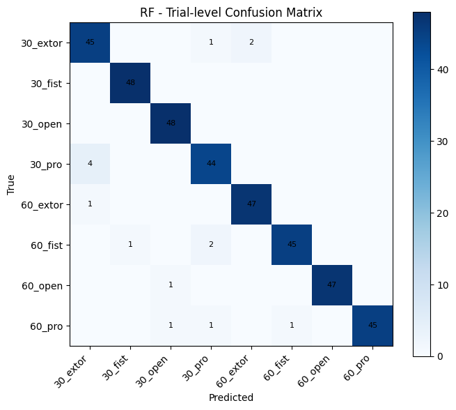
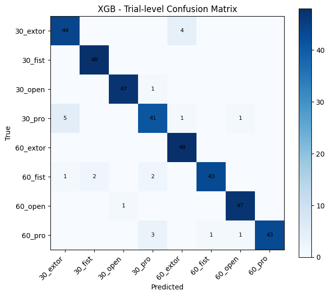

# sEMG 손동작 및 팔꿈치 각도 분류 모델 비교

본 프로젝트는 sEMG(surface Electromyography) 신호를 이용하여 손동작과 팔꿈치 각도를 동시에 분류하고, SVM, Random Forest, XGBoost의 성능을 비교한 재현 실험이다.

분류 대상은 4개의 손동작과 2개의 팔꿈치 각도 조합으로 구성된 총 8개 클래스이다.

- 30_extor
- 30_fist
- 30_open
- 30_pro
- 60_extor
- 60_fist
- 60_open
- 60_pro

## 1. 코드 설명

### 데이터

다음 공개 sEMG 데이터셋을 사용하였다.

`TestUser-alt-dev/sEMG-Hand-Gesture-Elbow-Angle-Dataset`

데이터는 8명의 피험자와 8개의 동작·각도 조합으로 구성되어 있으며, 각 CSV 파일에는 5채널 sEMG 신호와 time, onset, mark 정보가 포함되어 있다.

본 실험에서는 `mark` 정보를 기준으로 각 시행(trial)을 구분하였다.

### 전처리 및 특징 추출

각 trial은 5초 길이로 구성하였으며 다음 과정을 적용하였다.

1. 5채널 sEMG 신호 사용
2. 60 Hz notch filter 적용
3. 20–450 Hz band-pass filter 적용
4. trial 내부에서 2초 분석 구간 추출
5. 200 ms window, 100 ms hop을 이용한 sliding window 적용
6. 각 window에서 시간 영역 특징 추출

사용한 특징은 다음과 같다.

- RMS (Root Mean Square)
- MAV (Mean Absolute Value)
- WL (Waveform Length)
- ZC (Zero Crossing)
- SSC (Slope Sign Change)

5개의 특징을 5개 채널에서 계산하여 하나의 window당 총 25차원의 특징 벡터를 생성하였다.

### 데이터 분할

동일한 trial에서 생성된 window가 학습 데이터와 테스트 데이터에 동시에 포함되는 것을 방지하기 위해 window 생성 이전에 trial 단위로 데이터를 분할하였다.

- Train: 80%
- Test: 20%
- Stratified split
- Random state: 42

학습 데이터에 대해 `StandardScaler`를 학습한 후 테스트 데이터에는 동일한 scaler를 적용하였다.

### 사용 모델

다음 세 가지 머신러닝 모델을 비교하였다.

- SVM
- Random Forest
- XGBoost

### 평가 방식

초기에는 각 200 ms window를 독립적인 샘플로 평가하였다.

이후 하나의 trial에서 생성된 19개 window의 예측 결과를 majority voting으로 통합하여 하나의 trial에 대한 최종 예측을 결정하였다.

최종 성능 비교에는 trial-level majority voting 결과를 사용하였다.

### 실행 방법

```bash
pip install numpy pandas matplotlib scipy scikit-learn xgboost
python main.py
```

### 파일 설명

| 파일 | 설명 |
| --- | --- |
| `main.py` | 데이터 전처리, 특징 추출, 모델 학습 및 성능 평가 |
| `confusion_trial_SVM.png` | SVM Trial-level Confusion Matrix |
| `confusion_trial_RF.png` | Random Forest Trial-level Confusion Matrix |
| `confusion_trial_XGB.png` | XGBoost Trial-level Confusion Matrix |

## 2. 모델 성능 비교

### Trial-level 성능

각 trial에서 생성된 19개의 window 예측을 majority voting으로 통합하여 평가하였다.

| Model | Accuracy | Precision | Recall | F1-score |
| --- | ---: | ---: | ---: | ---: |
| SVM | 78.39% | 80.38% | 78.39% | 78.79% |
| Random Forest | **96.09%** | **96.17%** | **96.09%** | **96.10%** |
| XGBoost | 94.01% | 94.17% | 94.01% | 93.99% |

Random Forest가 모든 평가 지표에서 가장 높은 성능을 보였으며, XGBoost가 두 번째로 높은 성능을 나타냈다. SVM은 두 트리 기반 모델보다 낮은 성능을 보였다.

### Window-level과 Trial-level 비교

초기 window-level 평가 결과는 다음과 같았다.

| Model | Window Accuracy | Trial Accuracy |
| --- | ---: | ---: |
| SVM | 48.18% | 78.39% |
| Random Forest | 63.34% | 96.09% |
| XGBoost | 62.49% | 94.01% |

개별 window를 독립적으로 평가했을 때보다 하나의 trial 내부 예측을 majority voting으로 통합했을 때 모든 모델의 성능이 크게 향상되었다.

### 5-fold 교차검증

Trial-level majority voting을 적용한 5-fold 교차검증 결과는 다음과 같다.

| Model | Accuracy |
| --- | ---: |
| SVM | 76.72 ± 0.56% |
| Random Forest | **95.73 ± 1.21%** |
| XGBoost | 95.26 ± 1.26% |

Random Forest가 가장 높은 평균 정확도를 기록하였으며 XGBoost가 매우 근접한 성능을 보였다.

### 통계 검정

5-fold 교차검증에서 얻은 모델별 정확도에 대응표본 t-검정을 적용하였다.

| 비교 | p-value | 결과 |
| --- | ---: | --- |
| SVM vs Random Forest | < 0.0001 | 유의함 |
| SVM vs XGBoost | < 0.0001 | 유의함 |
| Random Forest vs XGBoost | 0.2080 | 유의하지 않음 |

SVM은 Random Forest 및 XGBoost와 통계적으로 유의한 성능 차이를 보였다.

반면 Random Forest와 XGBoost 사이의 성능 차이는 통계적으로 유의하지 않았다.

## 3. Confusion Matrix 분석

### SVM


- 가장 잘 분류된 클래스: `30_open`
- 상대적으로 오분류가 많았던 클래스: `30_pro`, `60_extor`, `60_fist`
- 주요 오분류 유형: `30_pro → 30_extor`, `60_extor → 30_extor` 등
- 분석: SVM은 Random Forest와 XGBoost보다 손동작 및 팔꿈치 각도 조합 사이의 경계를 명확히 구분하지 못하여 상대적으로 많은 오분류가 발생하였다.

### Random Forest



- 가장 잘 분류된 클래스: `30_fist`, `30_open`
- 가장 많이 오분류된 클래스: `30_pro`
- 주요 오분류 유형: `30_pro → 30_extor`
- 분석: 대부분의 클래스에서 매우 높은 분류 정확도를 보였으며, `30_fist`와 `30_open`은 모든 test trial을 정확하게 분류하였다. 일부 pronation 계열에서 소수의 오분류가 발생하였다.

### XGBoost



- 가장 잘 분류된 클래스: `30_fist`, `60_extor`
- 상대적으로 오분류가 많았던 클래스: `30_pro`, `60_pro`
- 주요 오분류 유형: `30_pro → 30_extor`, `60_pro → 30_pro`
- 분석: Random Forest와 유사하게 높은 분류 성능을 보였으나 일부 pronation 계열에서 상대적으로 많은 오분류가 나타났다.

Window-level 평가와 비교하면 majority voting을 적용한 trial-level 평가에서 동일 동작의 30°와 60° 사이의 혼동이 크게 감소하였다.

## 4. 최종 결과

- 가장 성능이 좋은 모델: **Random Forest**
- Trial-level Accuracy: **96.09%**
- Trial-level F1-score: **96.10%**
- 5-fold Accuracy: **95.73 ± 1.21%**
- 가장 성능이 낮은 모델: **SVM**
- 주요 오분류 클래스: `30_pro` 등 pronation 관련 클래스

Random Forest가 세 모델 중 가장 높은 분류 성능을 보였으며, 계산 비용 또한 가장 낮았다.

모델별 계산 시간은 다음과 같다.

| Model | 학습 시간 | 추론 시간 |
| --- | ---: | ---: |
| SVM | 73.7773 s | 20.9345 s |
| Random Forest | **20.0526 s** | **0.1507 s** |
| XGBoost | 26.4609 s | 0.5277 s |

초기 window-level 평가에서는 Random Forest 정확도가 63.34%로 논문에서 제시된 약 96% 수준보다 크게 낮게 나타났다. 그러나 동일 trial에 포함된 19개 window의 결과를 majority voting으로 통합한 결과 Random Forest의 정확도가 96.09%까지 상승하였다.

이를 통해 개별 window의 일시적인 오분류를 그대로 최종 결과로 사용하는 것보다, 하나의 trial 내부 예측을 통합하는 방식이 안정적인 분류 결과를 얻는 데 중요하다는 점을 확인하였다.

다만 본 실험은 trial-wise 분할을 사용하였기 때문에 동일 피험자의 데이터가 학습 데이터와 테스트 데이터에 모두 포함될 수 있다. 따라서 본 결과가 새로운 피험자에 대한 일반화 성능을 직접적으로 의미하지는 않는다. 또한 별도의 하이퍼파라미터 최적화를 수행하지 않았기 때문에 각 모델의 절대적인 최적 성능을 나타내는 결과라고 보기는 어렵다.
